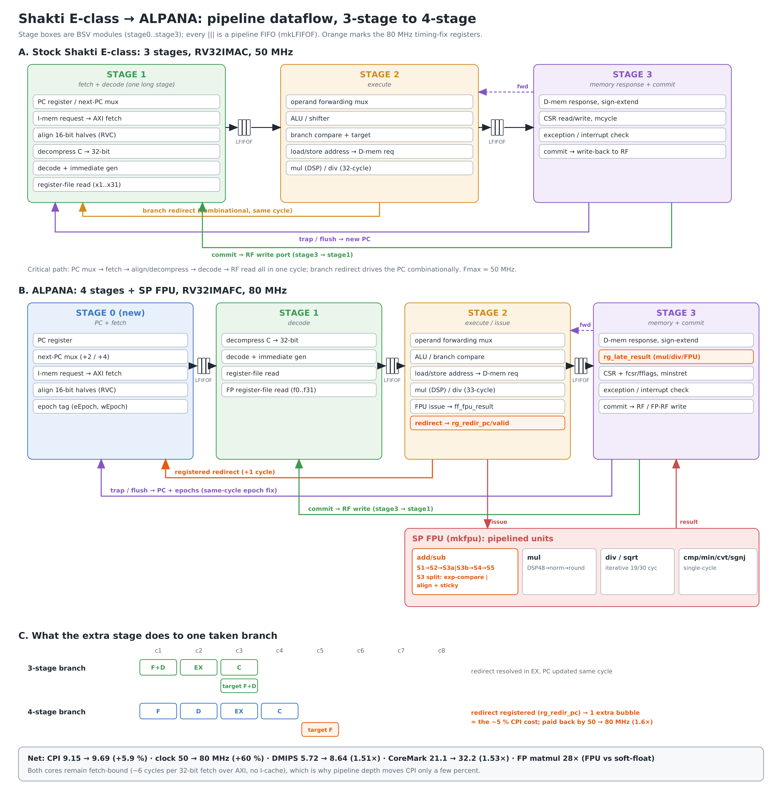
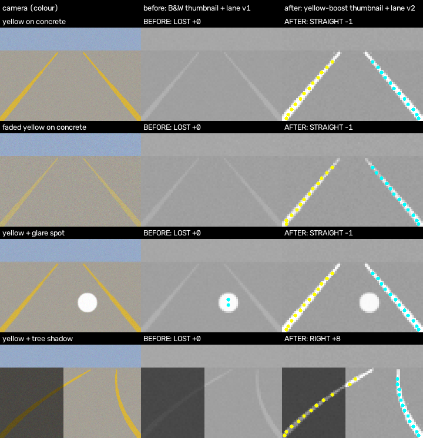

# ALPANA-SOC

**ALPANA_SOC** is a RISC-V SoC built from the Shakti E-class core. It runs on the Digilent **Nexys 4 DDR** (Artix-7 xc7a100t), and comes with the **ALPANA SDK**.

| | |
|---|---|
| Core | Shakti E-class, extended to **4 pipeline stages**, **RV32IMAFC** with a single-precision **FPU** |
| Clock | **80 MHz** (timing closed, WNS +0.027 ns) |
| Memory | **128 MB DDR2** (Xilinx MIG, AXI4) + 8 KB on-chip boot RAM |
| Peripherals | UART ×3, SPI ×2 (QSPI flash, SPI1), I2C ×2, PWM ×6, 32 GPIO, pin-mux, CLINT, PLIC |
| Debug | RISC-V debug 0.13 over the board's USB-JTAG (BSCANE2), OpenOCD + GDB |
| SDK | fork of shakti-sdk: `TARGET=alpana`, FPU on, ALPANA drivers (board, SPI1, servo/PWM), `ALPANA_FAST` on-chip code, examples, benchmarks |



## Repository layout
```
hw/
  rtl/soc/          Bluespec-generated Verilog of the SoC + core (53 files)
  rtl/top/          fpga_top.v (board top level), multiplier_rtl.v (optional RTL multiplier)
  mem/boot.mem      boot ROM image (0x1000)
  ip/               Xilinx IP configs: clk_wiz_0, mig_7series_0 (+ mig_a.prj), axi_clock_converter_0, multiplier
  constraints/      constraints.xdc (pins + timing)
  scripts/          create_project.tcl : rebuilds the Vivado project
  ddr2/             DDR2/MIG integration notes
sdk/                ALPANA SDK (software, drivers, examples, tools, docs)
docs/               pinout, results, images, project brief
```

## Quick start
1. **Hardware (Vivado 2025.2):**
   ```
   cd hw/scripts
   vivado -mode batch -source create_project.tcl
   ```
   Then open `hw/vivado/ALPANA_SOC.xpr`, generate the bitstream and program the board. Details: [`sdk/doc/ALPANA_Setup_Guide.md`](sdk/doc/ALPANA_Setup_Guide.md), Part A.
2. **Software (WSL Ubuntu 20.04 + shakti-tools):** see the setup guide, Parts B–C, then:
   ```bash
   cp -r sdk ~/alpana-sdk && source ~/alpana-sdk/alpana_tools/env.sh
   cd ~/alpana-sdk && make software PROGRAM=alpana_hello
   alpana-ocd            # terminal 1
   alpana-uart           # terminal 2
   alpana-run software/examples/alpana_applns/alpana_hello/output/alpana_hello.shakti   # terminal 3
   ```

## Documentation
| Document | Contents |
|---|---|
| [Setup guide](sdk/doc/ALPANA_Setup_Guide.md) | tools to install, the Verilog file list, IP settings, Vivado build, SDK install, first run |
| [SDK guide](sdk/doc/ALPANA_SDK_Guide.md) | memory map, build system, drivers, examples, performance, troubleshooting |
| [Pinout](sdk/doc/ALPANA_SOC_Pinout.md) | every Pmod / on-board pin and the pin-mux register |
| [Board results](docs/results/BOARD_RESULTS.md) | functional tests and benchmarks on the board |
| [Performance report](docs/results/alpana_perf_report.md) | 3-stage vs 4-stage + FPU (RTL simulation) |
| [Lane detection demo](sdk/software/examples/alpana_applns/esp32cam_lane/README.md) | ESP32-CAM → SPI → ALPANA lane detection → servo |


## Demo: lane detection on ALPANA
An ESP32-CAM streams frames over SPI. ALPANA finds the lanes in C (using the FPU), drives a steering servo with PWM, and streams the video and overlay to the PC.



## Results (board, DDR2, no cache)
| Benchmark | Result |
|---|---|
| Dhrystone | 1.20 DMIPS (0.015 DMIPS/MHz) |
| CoreMark | 4.26 iter/s (0.053 CoreMark/MHz) |
| Stress tests | all pass |

In RTL simulation (fast memory) the same core reaches 0.111 DMIPS/MHz and 0.400 CoreMark/MHz. The core has no cache, so on the board every instruction fetch from DDR2 costs about 48 cycles. The SDK's `ALPANA_FAST` option moves hot loops into on-chip RAM to work around this.

## Acknowledgements
Special thanks to:

- **Thapar Institute of Engineering and Technology (TIET), Patiala**, where this work was carried out
- **Department of Electronics and Communication Engineering (DECE), TIET**, for the lab, the FPGA hardware and the tools
- **Dr. Anil Singh Rawat**, Associate Professor@DECE, TIET, for guidance and support
- **Dr. Manu Bansal**, Associate Professor@DECE, TIET, for guidance and support

## Credits and licenses
| Part | Origin | License |
|---|---|---|
| `hw/rtl/soc/*` (E-class core, SoC, peripherals) | [Shakti project, IIT Madras](https://shakti.org.in), modified for ALPANA (4-stage, FPU, timing fixes) | BSD-3-Clause, see [`hw/LICENSE-SHAKTI-ECLASS`](hw/LICENSE-SHAKTI-ECLASS) |
| `hw/rtl/soc/` Bluespec library modules (`FIFO*.v`, `Sync*.v`, …) | Bluespec Inc. / B-Lang `bsc` | BSD-3-Clause (as distributed with bsc) |
| `sdk/` | fork of shakti-sdk (IIT Madras) | GPL-3.0, see [`sdk/LICENSE`](sdk/LICENSE) |
| `hw/ip/*.xci` | Xilinx/AMD IP configurations only (no IP source) | regenerate in Vivado under the AMD license |
| ALPANA additions (top level, drivers, examples, docs) | Bhavya Bansal | MTECH VLSI  |
