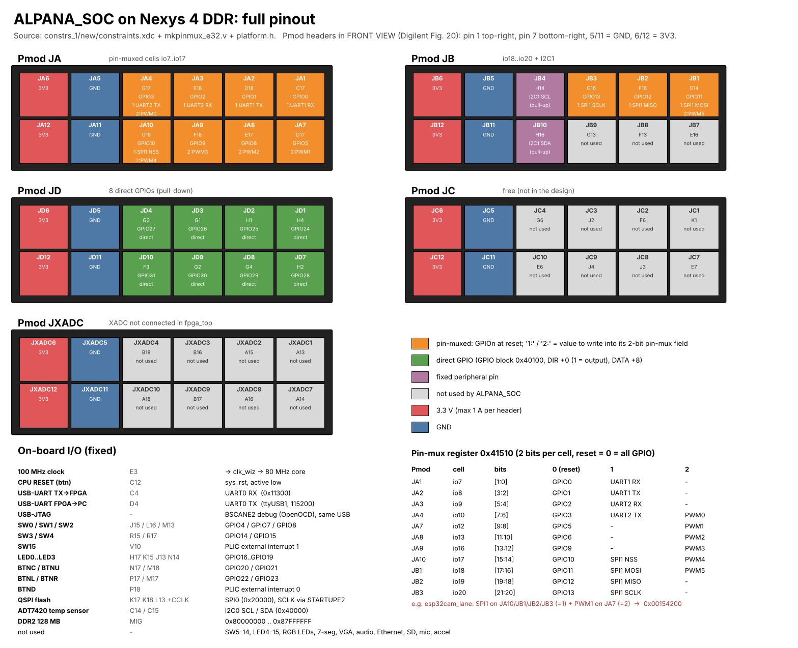

# ALPANA_SOC on Nexys 4 DDR: full pinout



Sources:
- `constrs_1/new/constraints.xdc`
- `mkpinmux_e32.v` / `mkSoc_e32.v` (pin-mux functions and GPIO numbering)
- `bsp/third_party/alpana/platform.h` (base addresses)

All I/O is LVCMOS33 (3.3 V). **Inputs must not exceed 3.3 V.**

## Reading a Pmod header
In the Digilent Fig. 20 front view, the header looks like this:
```
 top row:     6(3V3)  5(GND)  4   3   2   1      <- pin 1 = top-right
 bottom row: 12(3V3) 11(GND) 10   9   8   7      <- pin 7 = bottom-right
```

## Pmod JA: pin-muxed cells (pull-down)
Each pin is a GPIO after reset. Write the value in the pin-mux register to switch it to a peripheral.

| Pin | FPGA | Cell | 0 (reset) | 1 | 2 |
|---|---|---|---|---|---|
| JA1 | C17 | io7 | GPIO0 | UART1 RX | – |
| JA2 | D18 | io8 | GPIO1 | UART1 TX | – |
| JA3 | E18 | io9 | GPIO2 | UART2 RX | – |
| JA4 | G17 | io10 | GPIO3 | UART2 TX | PWM0 |
| JA7 | D17 | io12 | GPIO5 | – | PWM1 |
| JA8 | E17 | io13 | GPIO6 | – | PWM2 |
| JA9 | F18 | io16 | GPIO9 | – | PWM3 |
| JA10 | G18 | io17 | GPIO10 | SPI1 NSS | PWM4 |

## Pmod JB
| Pin | FPGA | Function |
|---|---|---|
| JB1 | D14 | io18 (mux): 0 GPIO11 / 1 SPI1 MOSI / 2 PWM5 |
| JB2 | F16 | io19 (mux): 0 GPIO12 / 1 SPI1 MISO |
| JB3 | G16 | io20 (mux): 0 GPIO13 / 1 SPI1 SCLK |
| JB4 | H14 | **I2C1 SCL** (fixed, pull-up) |
| JB10 | H16 | **I2C1 SDA** (fixed, pull-up) |
| JB7, JB8, JB9 | E16, F13, G13 | not used |

## Pmod JD: 8 direct GPIOs (pull-down)
| Pin | JD1 | JD2 | JD3 | JD4 | JD7 | JD8 | JD9 | JD10 |
|---|---|---|---|---|---|---|---|---|
| FPGA | H4 | H1 | G1 | G3 | H2 | G4 | G2 | F3 |
| GPIO | 24 | 25 | 26 | 27 | 28 | 29 | 30 | 31 |

## Pmod JC and JXADC
Neither is used by the current design:
- JC1–JC10 (K1 F6 J2 G6 / E7 J3 J4 E6) are free.
- The XADC block exists at 0x41000, but it is not connected in `fpga_top`.

## Pin-mux register: `0x41510` (`PINMUX_CONFIGURE_REG`)
Each cell has a 2-bit field. The reset value is 0, so every cell starts as GPIO. With the SDK, use `alpana_pinmux_set(PIN_JAx, PINMUX_GPIO / PINMUX_ALT1 / PINMUX_ALT2)`.

| Bits | [1:0] | [3:2] | [5:4] | [7:6] | [9:8] | [11:10] | [13:12] | [15:14] | [17:16] | [19:18] | [21:20] |
|---|---|---|---|---|---|---|---|---|---|---|---|
| Pmod | JA1 | JA2 | JA3 | JA4 | JA7 | JA8 | JA9 | JA10 | JB1 | JB2 | JB3 |

Example: `esp32cam_lane` puts SPI1 on JA10/JB1/JB2/JB3 (value 1) and PWM1 on JA7 (value 2), so the register is `0x00154200`.

## On-board I/O (fixed)
| Board item | FPGA | ALPANA_SOC |
|---|---|---|
| 100 MHz oscillator | E3 | clk_wiz → 80 MHz core clock |
| CPU RESET button | C12 | `sys_rst` (active low) |
| USB-UART (PC → FPGA) | C4 | UART0 RX |
| USB-UART (FPGA → PC) | D4 | UART0 TX: `/dev/ttyUSB1`, 115200 at start |
| USB-JTAG | – | BSCANE2 debug module (OpenOCD, same USB cable) |
| SW0 / SW1 / SW2 / SW3 / SW4 | J15 / L16 / M13 / R15 / R17 | GPIO4 / GPIO7 / GPIO8 / GPIO14 / GPIO15 |
| SW15 | V10 | PLIC external interrupt 1 |
| LED0..LED3 | H17 / K15 / J13 / N14 | GPIO16..GPIO19 |
| BTNC / BTNU / BTNL / BTNR | N17 / M18 / P17 / M17 | GPIO20 / GPIO21 / GPIO22 / GPIO23 |
| BTND | P18 | PLIC external interrupt 0 |
| QSPI flash | K17 (MOSI), K18 (MISO), L13 (CS), CCLK | SPI0. SCLK goes through STARTUPE2 |
| ADT7420 temperature sensor | C14 / C15 | I2C0 SCL / SDA (pull-ups) |
| DDR2 128 MB | MIG | 0x8000_0000 – 0x87FF_FFFF |
| Not used | – | SW5–SW14, LED4–LED15, RGB LEDs, 7-segment, VGA, audio, Ethernet, micro-SD, microphone, accelerometer |

## GPIO numbering (32-bit GPIO block)
| GPIO | Where |
|---|---|
| 0–3, 5, 6, 9–13 | pin-muxed cells on JA / JB (tables above) |
| 4, 7, 8, 14, 15 | SW0–SW4 |
| 16–19 | LED0–LED3 |
| 20–23 | BTNC, BTNU, BTNL, BTNR |
| 24–31 | JD1–JD4, JD7–JD10 |

## Peripheral addresses (`platform.h`)
| Block | Base |
|---|---|
| Boot RAM | 0x0000_1000 – 0x0000_2FFF (SDK: boot code, `ALPANA_FAST`, park at 0x2C00) |
| UART0 / UART1 / UART2 | 0x0001_1300 / 0x0001_1400 / 0x0001_1500 |
| SPI0 / SPI1 | 0x0002_0000 / 0x0002_0100 |
| PWM0..PWM5 | 0x0003_0000 + n·0x100 |
| I2C0 / I2C1 | 0x0004_0000 / 0x0004_1400 |
| GPIO | 0x0004_0100 (DIR +0x0, DATA +0x8) |
| XADC (not wired) | 0x0004_1000 |
| Pin-mux | 0x0004_1510 |
| CLINT | 0x0200_0000 (mtime = core clock / 256) |
| PLIC | 0x0C00_0000 |
| DDR2 | 0x8000_0000 (128 MB) |

## Safety notes
- The Pmod 3V3 pins can supply up to 1 A per header. Don't feed 5 V into any signal pin.
- Power servos and motors from an external supply, with a common GND.
- The PWM pins and pin-muxed cells have pull-downs, so they read 0 while they are unconfigured inputs.
