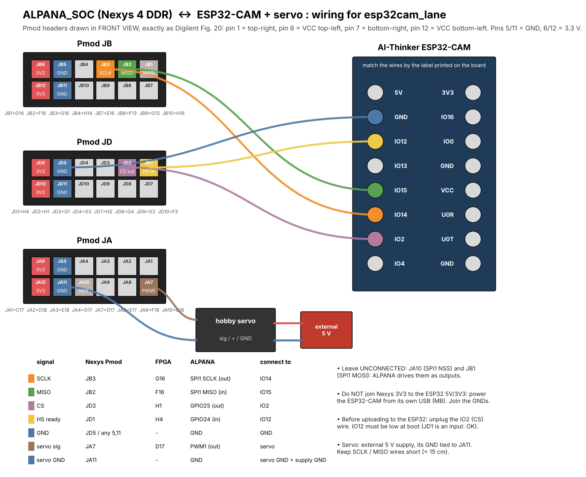

# esp32cam_lane: wiring (Nexys 4 DDR ↔ ESP32-CAM + servo)



## Reading a Pmod header
In the Digilent Fig. 20 front view, the header looks like this:
```
 top row:     6(3V3)  5(GND)  4   3   2   1      <- pin 1 = top-right
 bottom row: 12(3V3) 11(GND) 10   9   8   7      <- pin 7 = bottom-right
```

## Connections
| Signal | Nexys Pmod pin | FPGA pin | ALPANA function | Goes to |
|---|---|---|---|---|
| SCLK | **JB3** (top row, 3rd from right) | G16 | SPI1 SCLK, output | ESP32-CAM **IO14** |
| MISO | **JB2** (top row, 2nd from right) | F16 | SPI1 MISO, input | ESP32-CAM **IO15** |
| CS | **JD2** (top row, 2nd from right) | H1 | GPIO25, output | ESP32-CAM **IO2** |
| HS (ready) | **JD1** (top row, right-most) | H4 | GPIO24, input | ESP32-CAM **IO12** |
| GND | **JD5** (top row, 2nd from left), or any pin 5/11 | – | GND | ESP32-CAM **GND** |
| Servo signal | **JA7** (bottom row, right-most) | D17 | PWM1, output | servo signal (orange/yellow) |
| Servo GND | **JA11** (bottom row, 2nd from left) | – | GND | servo GND (brown) **and** the external supply's GND |
| Servo + | – | – | – | external 5 V supply (+) |

## Do not connect
- **JA10** (SPI1 NSS) and **JB1** (SPI1 MOSI). ALPANA drives these pins as outputs.
- Nexys **3V3** (pins 6/12) to the ESP32-CAM's 5V or 3V3 pins. Power the ESP32-CAM from its own USB (MB board), and power the servo from an external 5 V supply. **All GNDs must be joined.**

## Notes
- Before uploading to the ESP32, unplug the IO2 (CS) wire, then plug it back in after the upload.
- IO12 is a boot strap pin and must be low at ESP32 reset. JD1 is an FPGA input, so this is fine. Don't add a pull-up.
- Keep SCLK, MISO and GND wires short (< 15 cm). At 5 MHz, long jumpers cause `bad csum` errors. If you see them, try `SPI_BR 9`.
- Pin assignments come from `constrs_1/new/constraints.xdc`: `io19_cell`=F16, `io20_cell`=G16, `gpio_24`=H4, `gpio_25`=H1, `io12_cell`=D17.
